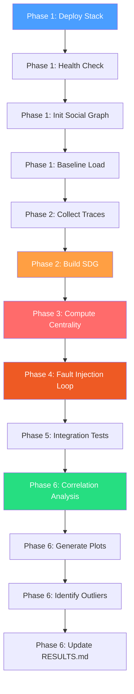
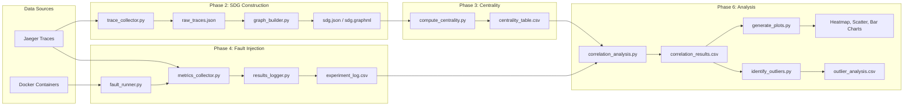
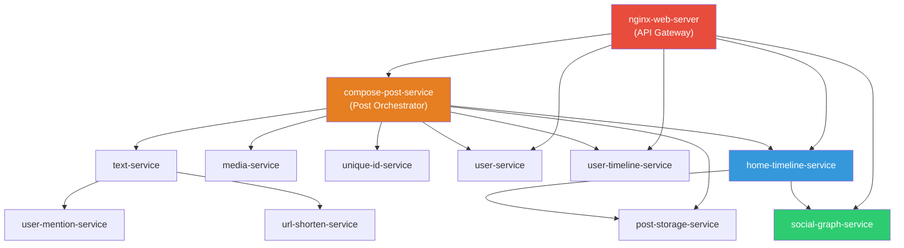
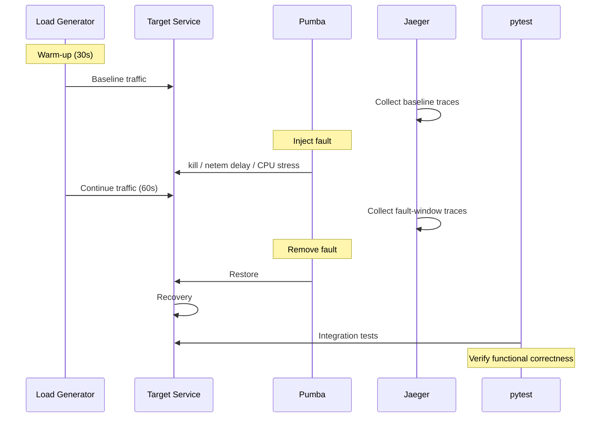

# Architecture

## Experiment Pipeline

## Data Flow

## DeathStarBench Social Network Architecture

The following diagram shows the microservice dependency structure of the
DeathStarBench Social Network application. This is the Service Dependency
Graph (SDG) that we construct from Jaeger traces.

## Fault Injection Process

For each service, we run the following cycle:

