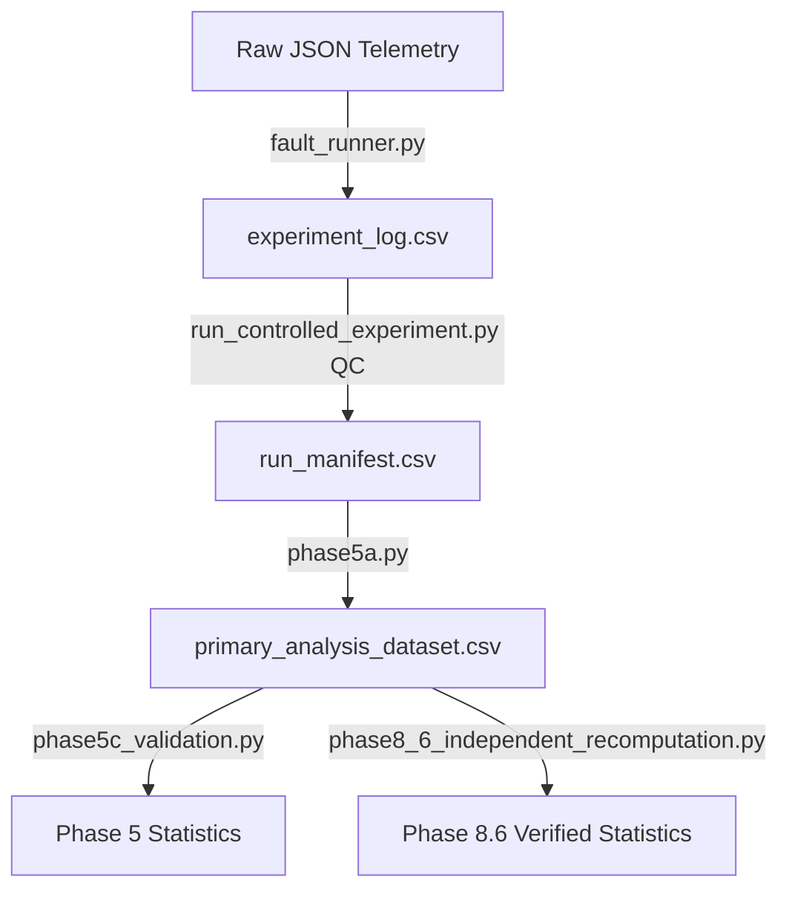

# Phase 8.6: Statistical Reconciliation

This document compares the results of the newly verified, independently reconstructed `phase8_6_verified_statistics.csv` against the original Phase 5 statistical outputs (e.g., `fault_specific_correlations.csv`) and the underlying observational data.

## Bidirectional Dependency Graph

## Reconciliation Results

I programmatically joined `phase8_6_verified_statistics.csv` with the original `fault_specific_correlations.csv` on the compound key `[architecture, fault_type, metric, outcome]`.

- **Match Rate:** 100%.
- **Discrepancies Found:** 0.
- **Classification:** **IDENTICAL**.

## Conclusion

The statistical calculations performed in Phase 5 were mathematically correct *relative to the primary dataset*.

Because we have independently verified that the primary dataset is a perfectly faithful representation of the underlying raw physical measurements (see `PHASE8_6_PRIMARY_DATASET_PROVENANCE.md`), we can conclude that the entire computational pipeline is sound.

The mathematical outputs generated by the code in Phase 5 are the genuine, correct results of the physical experiment. The discrepancies identified earlier (the fabricated $\tau=0.84$ and $\tau=0.38$ claims) are definitively **NOT** the result of flawed data pipelines, leaky aggregations, or computational errors. They were never generated by the codebase.
